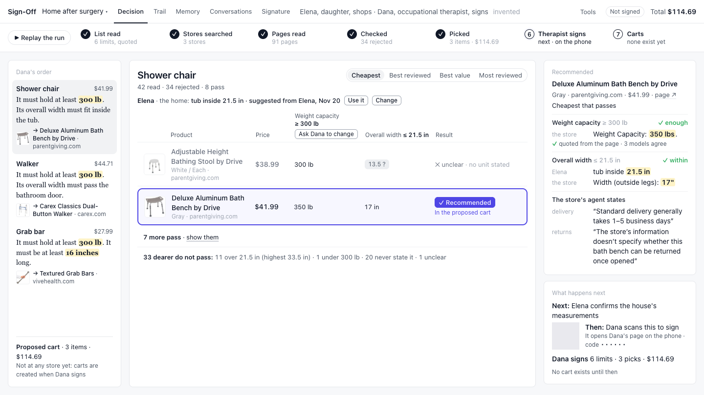
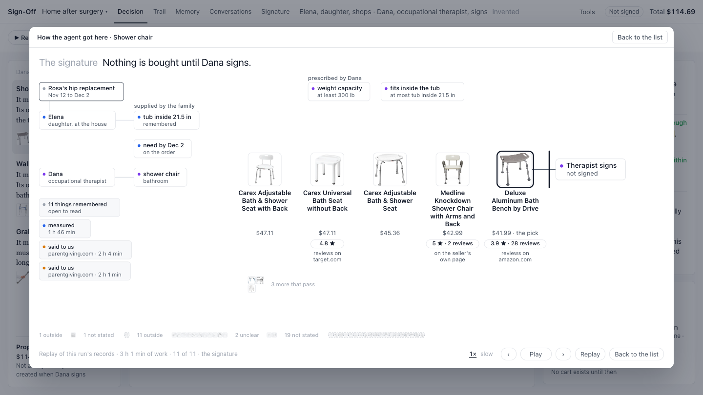
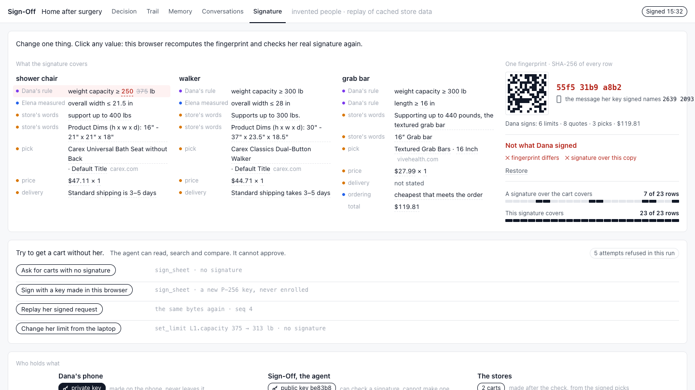
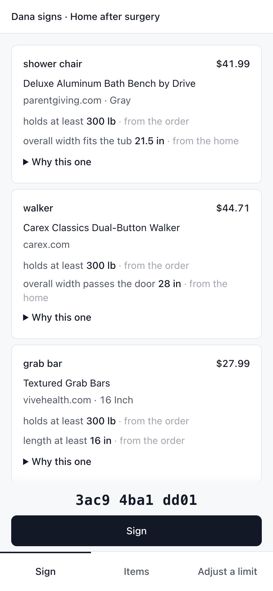

# Sign-Off

**A shopping agent that works under someone else's signature.**

▶ **[Demo video](<link>)**

## The problem
The person who wrote the rules is not the one shopping, and at the moment of buying the rules get bent
without her. A therapist writes what a patient's home needs and the family shops alone; a manager sets a
policy and an employee buys; and once an agent shops for you, you are the person who was not there. Today
the most an approver gets to approve is a total.

## What it does
The lead example (every person and message is invented; the stores, pages, prices and carts are real):
Rosa comes home from a hip replacement on December 2. Dana, her occupational therapist, wrote the order.
Her daughter Elena's agent shops three real stores.

1. **Reads the order.** Dana's limits are read from her written order, each with its sentence quoted.
   Elena supplies what Dana has not seen: the house's measurements.
2. **Shops and reads every page.** 91 product pages across carex.com, vivehealth.com and parentgiving.com.
   A store's figure counts only when code finds its exact quote in the store's text.
3. **Compares in code.** Code, not the model, compares each figure with the limit. A product whose page
   does not state the figure is "unclear" or "not stated" and is not bought on a guess.
4. **Waits for the approver.** Elena cannot change a limit; she can ask. Dana decides from her phone, and
   signs one fingerprint that covers her limits, the measurements, the stores' quotes, the picks, the prices
   and the ordering.
5. **Creates carts only after the signature**, for exactly the signed picks. Nothing is checked out.

On `/seal/` anyone can change one covered value and watch the check fail, and fire real attempts to get a
cart without her: each is refused by the server.

| | |
|---|---|
|  |  |
| **The decision screen.** Dana's limits, each product's figures, the recommended pick and what happens next. | **Replay the run.** How the agent got to the pick, stage by stage; the last frame waits for Dana. |
|  |  |
| **`/seal/` with one limit changed.** The fingerprint differs and her signature no longer checks. | **Dana's phone.** What she signs, the short code that matches the laptop, and Sign. |

## How it works
- **A reading model with no tools** gets one store page and the names of the figures, and proposes a
  figure, a unit and a quote. Code finds the quote at stated offsets and applies one set of number rules
  to every reader (Claude Sonnet, and Qwen on Superlinked SIE). A disagreement makes the product unclear.
- **Limits are prescribed, never derived.** Their only source is the order its author wrote and signs.
- **The approver's phone holds an ECDSA P-256 key** made in its browser. Each request carries a sequence
  number and is signed against the SHA-256 fingerprint of the canonical sheet. A request is usable once.
- **Records:** a decision per candidate and state version, hash-chained receipts, a ledger of every
  outbound payload.
- **A guard in code** removes limits, measurements, names and health details from any message to a store's
  own agent, and stops the message when little is left.
- **Memory** holds only what a record states, each row with an owner and the receipt that made it.
- Stores are reached over their own MCP endpoints: search, product details, ask the store's agent, create
  cart. The client never calls a checkout tool.

## Tools and what each one does here
| Tool | Its job in this project | Where in the code |
|---|---|---|
| Senso | holds the order document; checks the sheet's sentences against it before the signature | `signoff/sign/senso.py` |
| SingleStore | products, figures, limits and decisions; the limit test as one SQL statement; memory and its vectors | `signoff/db/`, `signoff/memory/` |
| Superlinked SIE | the second reader; the writer and the span finder for the guard; embeddings for memory | `signoff/extract/`, `signoff/talk/`, `signoff/memory/meaning.py` |
| Statsig | the gate that switches the two-reader rule, which we measured | `signoff/obs/` |
| Amplitude | tool-call events for the run | `signoff/obs/` |
| Persona | an identity inquiry that gates the signature (sandbox: nobody is really checked) | `signoff/sign/` |
| Airbyte | a local sync that delivered store records to the database | `signoff/airbyte/` |
| Firedrill | a simulated shopper trying to get a struck product back | `evals/firedrill/` |
| Cognee | the run's knowledge as a graph, a dataset per owner with its permissions | `signoff/graph/` |
| Exa (not a sponsor) | web search for reviews, quoted with their source | `signoff/reviews/` |

## Measured
| | |
|---|---|
| Product pages read | 91, three real stores |
| Options checked | 152: 61 pass, 48 fail, 9 unclear, 34 never state the figure |
| "Both readers must agree", measured behind a gate | caught 5 misreads, blocked 27 right figures; we kept "a disagreement blocks" |
| Approver path attacked by an independent reviewer | six holes found, six fixed with a failing test first (`NOTES/REVIEW-approver-1500.md`) |
| Tests | `uv run pytest -q` |

Limits and caveats: store pages were fetched once on the day and read by two models; no person read every
page. The identity check is a sandbox. No store checks the signature. The guard stops some messages it
need not. A rating on the seller's own page is labelled as that.

## Run it
Needs [uv](https://docs.astral.sh/uv/) (it fetches the Python version the project pins).
```bash
uv sync
SIGNOFF_MODE=replay SIGNOFF_SHEET=sheet4 uv run uvicorn signoff.app:app --port 8800
```
Open http://localhost:8800 (the shopper's screen) and http://localhost:8800/phone/ (the approver). Replay
mode uses the store data saved on the day, needs no keys, and says so in the top bar. Live mode needs the
keys named in `.env.example`.

## Built today vs pre-existing
**Built during the hackathon (2026-11-20):** everything in this repository.
**Pre-existing, used but not built here:** FastAPI, uv, the sponsors' services and SDKs named above, the
stores' own MCP endpoints, and a generic hackathon starter kit (repo layout, a checks script and stream
conventions; no product code).

## License
MIT
